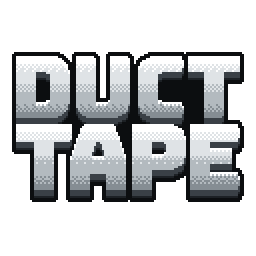

# DefinitivTim's Duct Tape

Small workarounds for problems in other mods, for as long as they are not fixed upstream. Each fix only applies
when the mod it patches is installed.

- Minecraft 1.21.1, NeoForge 21.1
- Install on the client and on the server. On a server only the Copycats+ crash guard is active
- Mod ID `definitivtim_duct_tape`, current version 1.4.0
- License: MIT. Made with AI assistance, see [AI notice](#ai-notice)

## Fixes

| Fix | Patched mod | Side | State |
|---|---|---|---|
| Material guard: no crash when the material of a copycat block is missing while its chunk is meshed | Create: Copycats+ 3.0.11 | both | active |
| Sky: the custom sky is no longer processed every frame while its option is switched off | Create: Cosmonautics | client | active |
| Redraw of unskinned copycats after their data arrived ([Copycats+ #419](https://github.com/copycats-plus/copycats/issues/419)) | Create: Copycats+ | client | in the code, not active yet |

## Status

- The sky fix writes a few `[Duct Tape Diag]` lines to the log. They are diagnostics, not errors.
- The sources in `src/` are a little behind the released jar: some changes of 1.3.7 and 1.3.8 were not written
  back, and the jar of 1.3.9 and later was produced by patching the compiled classes. The jar is the reference
  until the sources are brought back in line.
- If a patched mod fixes its problem itself, remove the matching fix or this mod.

## Building

There is no Gradle project yet. The released jar is compiled with plain `javac --release 21` against the small
stand-in classes in `stubs/` plus the jars of the patched mods, then packed with the files from `res/`.
`docs/DEVELOPMENT_NOTES.md` has the details and the history of every change.

## License

MIT, see [LICENSE](LICENSE). Free to use in modpacks and in other projects.
The mods this one patches at runtime keep their own licenses. This mod contains none of their code.

## AI notice

The code of DefinitivTim's Duct Tape was written by Claude (Anthropic), an AI. The idea, the requirements, the design decisions and
the testing come from DefinitivTim: he decided what the mod does and tested it in game in his modpack. Bug reports
and pull requests are welcome.
